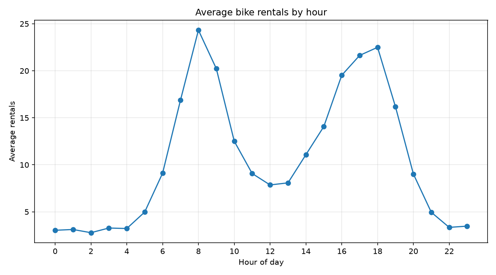
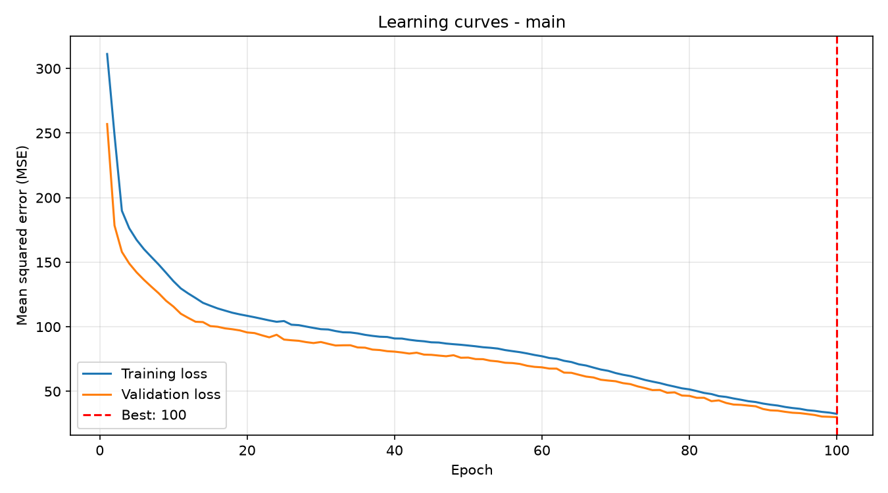
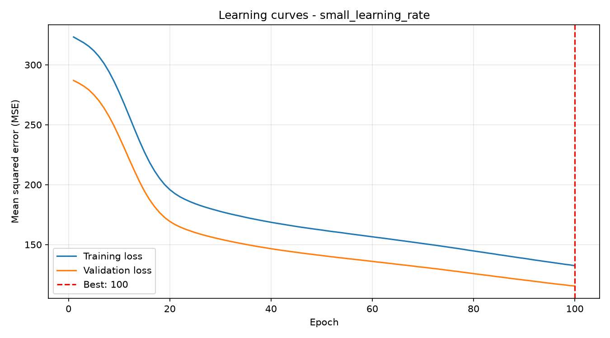
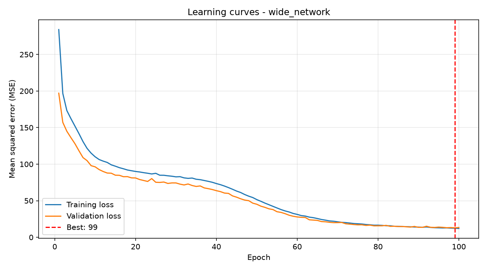

# Lakeshore Bike Demand

## What it does

This project predicts the number of bikes rented from a Lakeshore Bike Share station in the coming hour. It uses a neural network built with PyTorch and compares its predictions with two simpler models: a training-mean baseline and linear regression.

The neural network is trained using a custom training loop written from first principles. The project also includes automated tests, learning curves, controlled experiments, and reproducible reports.

## How to run it

### Requirements

- Conda
- Python 3.12
- Git

### Create the environment

Clone the repository and open its folder:

```bash
git clone https://github.com/arifelshafea/lab07-first-principles.git
cd lab07-first-principles
```

Create and activate the Conda environment:

```bash
conda env create -f environment.yml
conda activate lab07-first-principles
```

The environment installs the required packages from `requirements-dev.txt`, including PyTorch, NumPy, pandas, scikit-learn, matplotlib, pytest, and Ruff.

### Run training

```bash
python train.py
```

This command reproduces all three neural network experiments, evaluates the baselines, generates learning curves, and saves the results in `reports/`.

### Run the automated checks

```bash
python -m ruff format --check .
python -m ruff check .
python -m pytest
```

The project currently contains 22 passing automated tests.

## Data and split

The project uses the instructor-provided `bikes_data.py` generator, which creates 6,000 synthetic station-hour records using seed 2026.

Each record contains these input features:

- `hour`: Hour of the day, from 0 to 23.
- `temperature_c`: Temperature in degrees Celsius.
- `rain_mm`: Rainfall in millimetres.
- `wind_kph`: Wind speed in kilometres per hour.
- `is_weekend`: Whether the day is a weekend.
- `station_type`: Downtown, residential, or park.

The target variable is `rentals`, representing the number of bikes rented during the hour.

### Data splitting

A fixed random seed of 42 divides the data before preprocessing:

| Dataset | Percentage | Records |
|---|---:|---:|
| Training | 60% | 3,600 |
| Validation | 20% | 1,200 |
| Test | 20% | 1,200 |
| **Total** | **100%** | **6,000** |

The preprocessing pipeline uses `StandardScaler` for five numeric features and `OneHotEncoder` for the station type.

The scaler and encoder are fitted using training rows only. They then transform the validation and test rows without being refitted. This prevents data leakage.

One-hot encoding produces three station-type columns, giving the neural network eight input features in total.

The training DataLoader shuffles batches using a fixed seed. Validation and test DataLoaders do not shuffle.

## Model and training

The main neural network is implemented in `model.py` using PyTorch's `nn.Module`.

Its architecture is:

- Input: 8 features
- First hidden layer: 64 neurons with ReLU
- Second hidden layer: 32 neurons with ReLU
- Output: 1 value without an activation function

The output represents a predicted rental count rather than a probability.

### Training process

The custom training loop is implemented in `train.py` without using a framework training function such as `fit()`.

Each training batch follows these steps:

1. Perform a forward pass.
2. Calculate mean squared error (MSE).
3. Clear existing gradients using `optimizer.zero_grad()`.
4. Calculate gradients using `loss.backward()`.
5. Update the weights using `optimizer.step()`.

The project uses the Adam optimizer, a batch size of 64, and 100 epochs for each experiment.

Training loss, training MAE, validation loss, and validation MAE are recorded for every epoch.

The checkpoint with the lowest validation loss is saved in memory and restored when training finishes.

The project uses seed 42 for the data split, PyTorch initialization, and training DataLoader generator. Running `python train.py` twice on the same computer produced identical report files, verified using SHA-256 checksums.

## Results

The neural network is compared with two simple baselines trained on the same training records:

1. **Training-mean baseline:** Always predicts the mean number of rentals from the training data.
2. **Linear regression:** Uses scikit-learn's `LinearRegression` with the prepared input features.

The best neural network was selected from the experiments using validation performance. The final selected network was evaluated on the held-out test set only after model selection.

### Model comparison

Mean absolute error (MAE) measures the average absolute prediction error in bike rentals. Lower values indicate better predictions.

| Model | Validation MAE | Test MAE |
|---|---:|---:|
| Training mean | 9.5065 | 9.9534 |
| Linear regression | 8.4751 | 8.8376 |
| **Selected neural network** | **2.5148** | **2.7485** |

The selected model was the wider neural network with hidden layers of 128 and 64 neurons.

Its final test MAE was approximately 2.75 rentals. This is about 72.4% lower than the training-mean baseline and 68.9% lower than linear regression.

### Why linear regression performs worse

The rental-demand data contain nonlinear patterns related to the time of day, weather, and station type.

For example, commuting demand can increase near morning and evening rush hours, while other stations may experience stronger midday demand.

A straight-line model cannot easily represent these changing patterns and interactions using the supplied features.

The neural network uses hidden layers and ReLU activations to learn more flexible nonlinear relationships, helping it achieve lower prediction errors.

### Rentals by hour



This graph shows how average bike rentals change during the day. The changing pattern helps explain why a simple linear relationship is not sufficient.

### Main learning curve



The main network's training and validation losses decreased throughout the 100 epochs.

Training loss reached approximately 32.59, while validation loss reached approximately 30.01.

The best validation-loss epoch was 100. The curves remained relatively close together, with no clear evidence of sustained overfitting.

Because validation loss was still decreasing at the final epoch, the network may have benefited from more training, although additional epochs were not tested.

## Experiments

Three experiments were performed to understand how changing individual training settings affects neural network performance.

The main model uses two hidden layers of 64 and 32 neurons, a learning rate of 0.001, batch size 64, and 100 epochs.

Each additional experiment changes exactly one setting compared with the main model.

### Experiment comparison

| Experiment | Hidden layers | Learning rate | Best epoch | Best validation MAE | Final training loss | Final validation loss |
|---|---|---:|---:|---:|---:|---:|
| Main | (64, 32) | 0.001 | 100 | 3.8633 | 32.5919 | 30.0144 |
| Small learning rate | (64, 32) | 0.0001 | 100 | 7.0619 | 132.4240 | 115.4512 |
| Wide network | (128, 64) | 0.001 | 99 | 2.5148 | 12.0475 | 13.3759 |

All experiments used batch size 64 and 100 epochs.

### Experiment 1: Main network

The main network showed steady improvement throughout training.

Both training and validation losses decreased, and the lowest validation loss occurred at epoch 100.

The learning curves stayed close together, suggesting healthy learning without clear sustained overfitting.

### Experiment 2: Small learning rate

The learning rate was reduced from 0.001 to 0.0001 while keeping the architecture, batch size, and number of epochs unchanged.



The model learned more slowly and finished with a higher validation MAE of 7.0619 rentals.

Both training and validation losses were still decreasing at epoch 100.

This suggests underfitting within the available training budget because the smaller learning rate did not allow the model to make enough progress.

There was no clear evidence of overfitting.

### Experiment 3: Wider network

The hidden layers were increased from (64, 32) to (128, 64). All other settings remained unchanged.



The wider network learned faster and achieved the best validation MAE of 2.5148 rentals.

Its lowest validation loss occurred at epoch 99, with a value of approximately 12.94.

Validation loss increased slightly to 13.38 at epoch 100, but the curves did not show sustained overfitting.

The model's best checkpoint from epoch 99 was restored.

The wider network was selected because it achieved the lowest validation MAE among the three experiments.

### Experiment conclusion

The experiments show that training settings influence prediction performance.

A learning rate that is too small can produce slow learning, while a wider network can better represent nonlinear patterns in this dataset.

The wider network performed best under the tested conditions, but this does not prove that larger networks always perform better.

Detailed experiment results are saved in `reports/experiments.csv`.

## Limitations

The dataset is synthetic and was generated for educational purposes. It does not represent actual customers or rental activity at Lakeshore Bike Share stations.

The model uses only hour, temperature, rainfall, wind, weekend status, and station type.

It cannot account for factors such as holidays, special events, road closures, bike availability, station capacity, maintenance, or unexpected changes in customer behaviour.

The model predicts demand but cannot explain the exact reasons for every prediction.

Its output is also not restricted to nonnegative whole numbers, so predictions may require rounding and additional validation before operational use.

A planner should not use this educational model as the only basis for moving bikes or making staffing and financial decisions.

Before real-world deployment, the system would need real historical rental data, further validation, monitoring, and periodic retraining.
